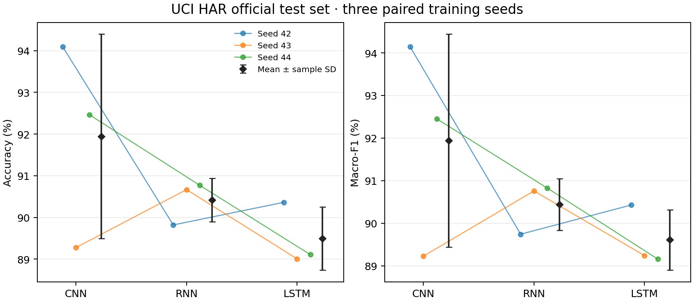

# CNN、RNN 与 LSTM 的人体活动识别比较

基于 PyTorch 的时序分类项目，使用 UCI HAR 智能手机传感器数据，比较一维 CNN、普通 RNN 和 LSTM 的识别准确率、训练效率及噪声鲁棒性。项目包含数据下载、按受试者划分、验证集调参、多个随机种子训练，以及冻结模型后的统一测试流程。

完整的方法、结果与讨论见项目报告：[在线阅读](reports/project_report.md) · [Word 文档](reports/project_report.docx)。实验设置见[实验协议](docs/EXPERIMENT_PROTOCOL.md)。

## 实验结果

三个模型使用相同的学习率搜索预算，再分别用种子 42、43、44 训练。在官方测试集的 9 名受试者、2,947 个窗口上，结果如下：

| 模型 | 参数量 | 准确率（%） | Macro-F1（%） |
| --- | ---: | ---: | ---: |
| CNN | 32,710 | 91.95 ± 2.45 | 91.94 ± 2.50 |
| RNN | 33,974 | 90.42 ± 0.52 | 90.44 ± 0.61 |
| LSTM | 29,606 | 89.49 ± 0.76 | 89.61 ± 0.71 |

数值为三个训练种子的均值 ± 样本标准差。CNN 的平均测试分数最高，RNN 的种子间波动较小；三者最常见的错误均发生在坐姿与站姿之间。



使用同一组 9 个冻结检查点，在测试输入中加入 20 dB 和 10 dB 的人工高斯噪声。10 dB 时，CNN、RNN 和 LSTM 的平均 Macro-F1 分别下降 0.05、0.15 和 0.25 个百分点。该实验使用一个固定噪声模板，结果反映这两档人工噪声下的敏感性。

详细结果与图表：[正式结果 CSV](reports/formal/per_run.csv) · [正式结果汇总](reports/formal/summary.json) · [噪声结果 CSV](reports/noise/per_run.csv) · [噪声降幅图](reports/noise/noise_drops.png)。

## 安装

参考环境为 Python 3.10、PyTorch 2.6.0。以下命令在项目根目录执行：

```powershell
conda create -n bddl_har python=3.10 -y
conda activate bddl_har
python -m pip install torch==2.6.0 --index-url https://download.pytorch.org/whl/cu124
python -m pip install -r requirements.txt
```

仅使用 CPU 时，将 PyTorch 安装地址末尾的 `cu124` 改为 `cpu`，并在运行命令中使用 `--device cpu`；PowerShell 脚本使用 `-Device cpu`。

## 快速开始

下载数据并各训练 5 轮，检查三个模型的完整运行流程：

```powershell
python -m har_compare.prepare --data-dir data
powershell -ExecutionPolicy Bypass -File scripts/run_smoke.ps1 -Python python -Device cuda
python -m har_compare.summarize --runs-root runs/smoke --output-dir reports/reproduced_smoke
```

数据自动从 UCI 官方来源下载。处理后的数据保存在 `data/processed/`，训练记录和权重保存在 `runs/smoke/`，轻量结果与图表导出到 `reports/reproduced_smoke/`。试跑仅评价验证集。

## 复现完整实验

### 调参与正式测试

每个模型在验证集上尝试学习率 `0.0003`、`0.001`、`0.003`，共用调参种子 41、最多 50 轮和 8 轮早停耐心值。随后用选定配置训练三个种子，冻结全部检查点，再统一评价官方测试集。

```powershell
python -m har_compare.prepare --data-dir data
python -m har_compare.formal_train tune --root runs/formal_v1 --device cuda
python -m har_compare.formal_train train --root runs/formal_v1 --device cuda
python -m har_compare.formal_test freeze --root runs/formal_v1
python -m har_compare.formal_test evaluate --root runs/formal_v1 --device cuda
python -m har_compare.formal_report --root runs/formal_v1 --output reports/reproduced_formal
```

### 噪声鲁棒性

完成正式测试后，使用相同检查点生成噪声协议、评估两档带噪输入并导出结果：

```powershell
python -m har_compare.noise_eval plan --root runs/formal_v1
python -m har_compare.noise_eval evaluate --root runs/formal_v1 --device cuda
python -m har_compare.noise_report --input runs/formal_v1/noise_v1/results.json --output reports/reproduced_noise
```

所有模型共用同一份噪声输入。降幅按每个检查点的干净分数减去带噪分数计算，再汇总三个种子。复现结果写入 `reports/reproduced_*`，仓库附带的原实验结果位于 `reports/smoke/`、`reports/formal/` 和 `reports/noise/`。重复复现且已有实验目录时，为新实验统一换用新的 `--root`、`--output` 和对应的 `--input` 路径；试跑可通过 `-OutputRoot` 指定新目录。

### 检查

```powershell
python -m unittest discover -s tests -v
```

检查覆盖分类指标、模型前向与反向传播、数据指纹，以及数据准备后的受试者隔离与标准化。

## 数据与目录

输入为 UCI HAR 官方预处理后的 `Inertial Signals`：每个窗口有 128 个时间点和 9 个通道，覆盖三轴身体加速度、角速度和总加速度。任务包含步行、上楼、下楼、坐姿、站姿、躺卧六类活动。

保留官方 9 人测试集，在其余 21 人中固定划分 17 人训练、4 人验证。训练、验证和测试集分别包含 5,844、1,508 和 2,947 个窗口。逐通道标准化参数仅由训练集估计。

```text
har_compare/    数据准备、模型、训练、评估与结果导出
scripts/        Windows 批量运行脚本
tests/          正确性检查
docs/           实验协议
reports/        项目报告、实验数据与图表
data/           本地下载与处理后的数据
runs/           本地训练记录与模型权重
```

仓库保存代码、报告和轻量实验结果。数据与模型权重由上述命令在本地生成。

## 数据来源

[Human Activity Recognition Using Smartphones](https://archive.ics.uci.edu/dataset/240/human+activity+recognition+using+smartphones)，UCI Machine Learning Repository，[DOI: 10.24432/C54S4K](https://doi.org/10.24432/C54S4K)，采用 [CC BY 4.0](https://creativecommons.org/licenses/by/4.0/) 许可。

Anguita, D., Ghio, A., Oneto, L., Parra, X., & Reyes-Ortiz, J. L. (2013). *A Public Domain Dataset for Human Activity Recognition Using Smartphones*. ESANN 2013.
