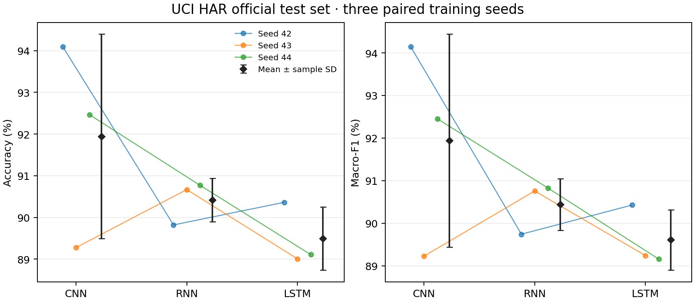
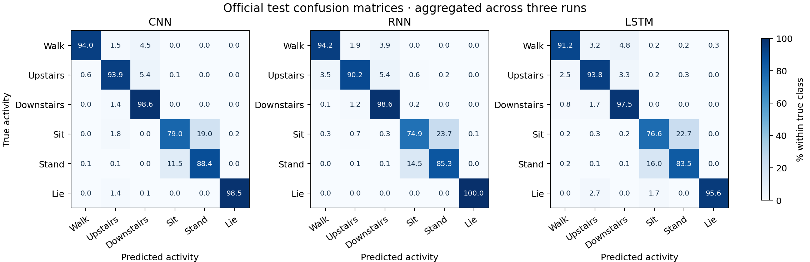
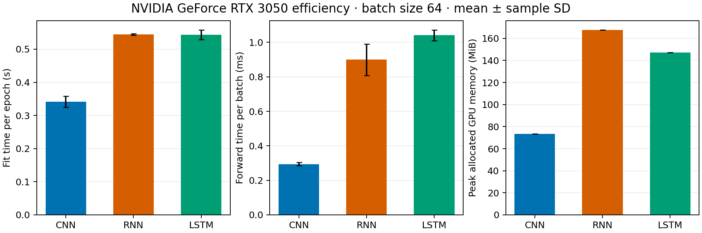
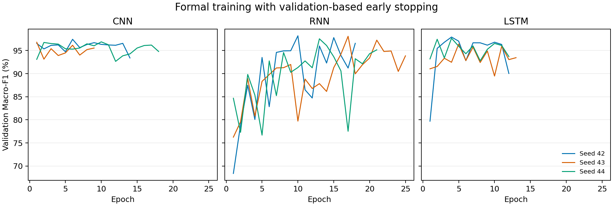

# CNN RNN 和 LSTM 的正式比较

在 UCI HAR 官方测试集上，CNN 的三种子平均 Macro-F1 最高，比第二位的 RNN 高 1.50 个百分点。CNN 在 2/3 个种子上的 Macro-F1 最高。

## 数据和模型选择

训练、验证和官方测试分别使用 17、4 和 9 名互不重叠的受试者，对应 5,844、1,508 和 2,947 个窗口。每个窗口有 128 个时间点和 9 个信号通道。标准化统计量只用训练集估计。

每个模型用同一个种子 41 尝试三个学习率。训练最多 50 轮，按验证 Macro-F1 选出最优轮次，连续 8 轮无提升则早停。验证分数相同则选择较小的学习率。三个模型采用相同批量大小、优化器和梯度裁剪阈值。选定学习率后使用种子 42、43、44 各自重新训练。9 个检查点全部记录哈希后，再统一评估官方测试集。

| 模型 | 学习率 | 验证准确率 | 验证 Macro-F1 | 最佳轮 / 完成轮 | 选中 |
| --- | ---: | ---: | ---: | ---: | --- |
| CNN | 0.0003 | 96.55% | 0.9678 | 9 / 17 |  |
| CNN | 0.001 | 96.88% | 0.9704 | 3 / 11 |  |
| CNN | 0.003 | 97.88% | 0.9801 | 6 / 14 | 是 |
| RNN | 0.0003 | 95.29% | 0.9509 | 31 / 39 |  |
| RNN | 0.001 | 96.62% | 0.9668 | 15 / 23 |  |
| RNN | 0.003 | 97.68% | 0.9755 | 10 / 18 | 是 |
| LSTM | 0.0003 | 93.37% | 0.9357 | 17 / 25 |  |
| LSTM | 0.001 | 94.63% | 0.9483 | 17 / 25 |  |
| LSTM | 0.003 | 97.28% | 0.9738 | 8 / 16 | 是 |

三个模型均选中候选范围的上边界 `0.003`，学习率结论限于本次搜索网格。

## 官方测试集

表中为 3 次正式训练的均值 ± 样本标准差。准确率和 Macro-F1 均用百分数表示。

| 模型 | 学习率 | 验证 Macro-F1 (%) | 测试准确率 (%) | 测试 Macro-F1 (%) |
| --- | ---: | ---: | ---: | ---: |
| CNN | 0.003 | 97.04 ± 0.35 | 91.95 ± 2.45 | 91.94 ± 2.50 |
| RNN | 0.003 | 97.94 ± 0.35 | 90.42 ± 0.52 | 90.44 ± 0.61 |
| LSTM | 0.003 | 97.34 ± 0.81 | 89.49 ± 0.76 | 89.61 ± 0.71 |

三次评估共用同一批测试受试者，标准差描述训练随机性。窗口有重叠，受试者也只有 9 名，因此这些结果的适用范围限于该数据集的固定划分和采集条件。

RNN 的平均验证 Macro-F1 最高，CNN 的平均测试 Macro-F1 最高。验证和测试来自不同受试者，且验证分数参与了轮次选择。

## 主要混淆

矩阵先将三个种子的计数相加，再按真实类别归一化。每个测试窗口重复计入三次。各模型最常见的双向混淆如下。

- CNN 的坐姿与站姿混淆合计 463 次，占该模型 712 次错误的 65.0%。
- RNN 的坐姿与站姿混淆合计 581 次，占该模型 847 次错误的 68.6%。
- LSTM 的坐姿与站姿混淆合计 590 次，占该模型 929 次错误的 63.5%。

## 计算效率

三个模型均在 NVIDIA GeForce RTX 3050 上顺序运行。参数量来自模型本身，其余指标为三个种子的均值 ± 样本标准差。

| 模型 | 参数量 | 完成轮数 | 总训练秒数 | 每轮秒数 | 64 样本前向毫秒 | 峰值分配显存 MiB |
| --- | ---: | ---: | ---: | ---: | ---: | ---: |
| CNN | 32,710 | 13.7 ± 4.5 | 4.62 ± 1.38 | 0.341 ± 0.016 | 0.295 ± 0.010 | 73.4 ± 0.0 |
| RNN | 33,974 | 21.3 ± 3.5 | 11.62 ± 1.92 | 0.545 ± 0.002 | 0.899 ± 0.091 | 167.8 ± 0.0 |
| LSTM | 29,606 | 12.3 ± 0.6 | 6.71 ± 0.50 | 0.544 ± 0.015 | 1.041 ± 0.031 | 147.3 ± 0.0 |

CNN 的平均每轮训练耗时最短，比第二快的 LSTM 少约 37%。

总训练时间包含每轮验证与最佳权重保存。每轮秒数按各次训练的总耗时除以完成轮数。批前向从验证集取 64 个样本，放入运行设备后预热 5 次并计时 30 次。CUDA 计时使用同步，峰值显存采用 PyTorch 分配器统计。CPU 运行的显存项记为 —。

## 复核材料

- [逐次正式运行与测试结果](per_run.csv)
- [完整学习率搜索表](tuning.csv)
- [机器可读汇总](summary.json)
- [预设实验配置](protocol.json)
- [配置选择记录](selection.json)
- [正式检查点哈希及冻结记录](freeze.json)
- [数据划分与标准化信息](data_manifest.json)
- [正式训练历史](training/) · [测试明细](test/) · [调参原始记录](tuning/)
