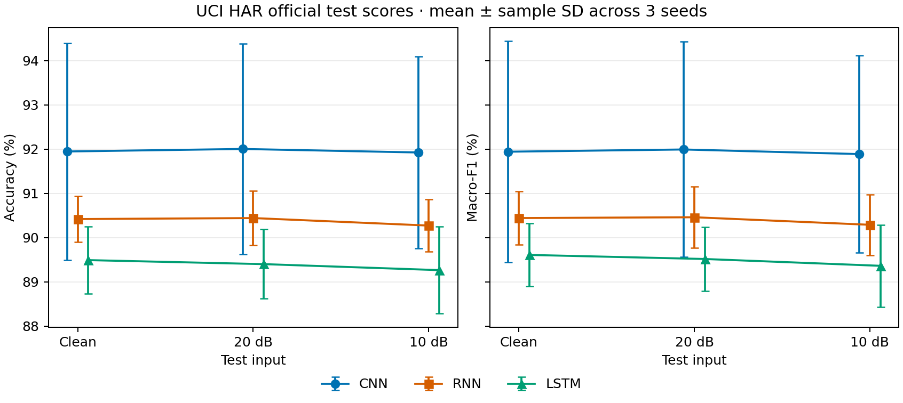
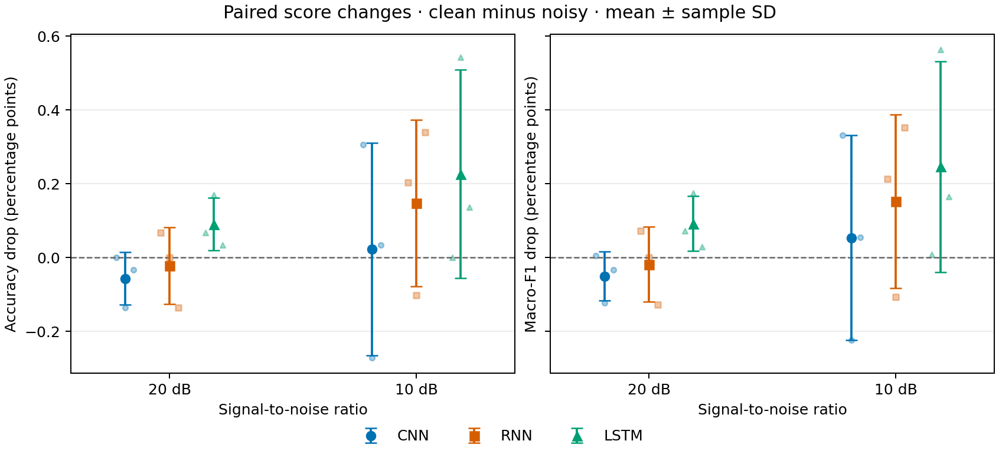

# 冻结模型的人工噪声鲁棒性实验

使用原有 9 个冻结检查点，在 UCI HAR 官方测试集的 9 名受试者、2,947 个窗口上评估。重新计算的干净输入结果已与原正式结果核对。[干净输入正式实验](../formal/README.md)

用 NumPy Generator(PCG64) 和固定噪声种子 `20261109` 生成一个高斯噪声模板。在标准化后的输入空间内，对每个窗口的每个通道沿 128 个时间点计算均方功率（含直流分量），按目标信噪比缩放噪声。零功率通道保持原值。两档共用同一噪声模板，各档输入由全部模型和训练种子共用。加噪后的输入转成 float32，无裁剪和二次标准化。

## 分数和配对降幅

数值为三个种子的均值 ± 样本标准差。分数用百分数表示。降幅按同一检查点的干净分数减去带噪分数，单位为百分点。负值表示在这一噪声实现下，平均分数略有上升。

| 模型 | 条件 | 准确率（%） | Macro-F1（%） | 准确率降幅（百分点） | Macro-F1 降幅（百分点） |
| --- | --- | ---: | ---: | ---: | ---: |
| CNN | 干净输入 | 91.95 ± 2.45 | 91.94 ± 2.50 | — | — |
| CNN | 20 dB | 92.00 ± 2.38 | 91.99 ± 2.43 | -0.06 ± 0.07 | -0.05 ± 0.07 |
| CNN | 10 dB | 91.92 ± 2.17 | 91.89 ± 2.23 | +0.02 ± 0.29 | +0.05 ± 0.28 |
| RNN | 干净输入 | 90.42 ± 0.52 | 90.44 ± 0.61 | — | — |
| RNN | 20 dB | 90.44 ± 0.61 | 90.46 ± 0.69 | -0.02 ± 0.10 | -0.02 ± 0.10 |
| RNN | 10 dB | 90.27 ± 0.59 | 90.29 ± 0.69 | +0.15 ± 0.23 | +0.15 ± 0.23 |
| LSTM | 干净输入 | 89.49 ± 0.76 | 89.61 ± 0.71 | — | — |
| LSTM | 20 dB | 89.40 ± 0.78 | 89.52 ± 0.73 | +0.09 ± 0.07 | +0.09 ± 0.07 |
| LSTM | 10 dB | 89.27 ± 0.98 | 89.36 ± 0.93 | +0.23 ± 0.28 | +0.25 ± 0.29 |

## 观察与适用范围

- 准确率与 Macro-F1 的均值在三种条件下均按 CNN、RNN、LSTM 从高到低排列。
- 10 dB 下，CNN 的平均 Macro-F1 降幅最小（+0.05 个百分点），LSTM 最大（+0.25）。三个模型的种子间降幅标准差均大于各自的平均降幅，模型间的鲁棒性差异应按描述性结果解读。
- CNN 在 10 dB 下的整体准确率平均变化为 -0.02 个百分点，但合并三个种子后，上楼的召回率下降 1.06 个百分点。整体指标掩盖了部分活动类别的变化。

测试受试者和噪声实现固定，标准差只描述训练种子之间的变化。结果对应这两档窗口级人工加性噪声，推广到其他噪声实现、受试者或真实传感器干扰仍需额外实验。

## 复核材料

- [逐检查点分数和配对降幅](per_run.csv)
- [模型汇总与混淆矩阵计数](summary.json)
- [原始评估记录及校验值](results.json)
- [预先固定的噪声协议](protocol.json)
