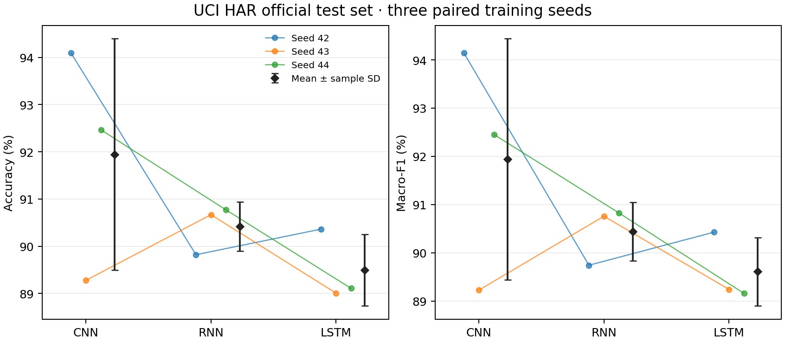
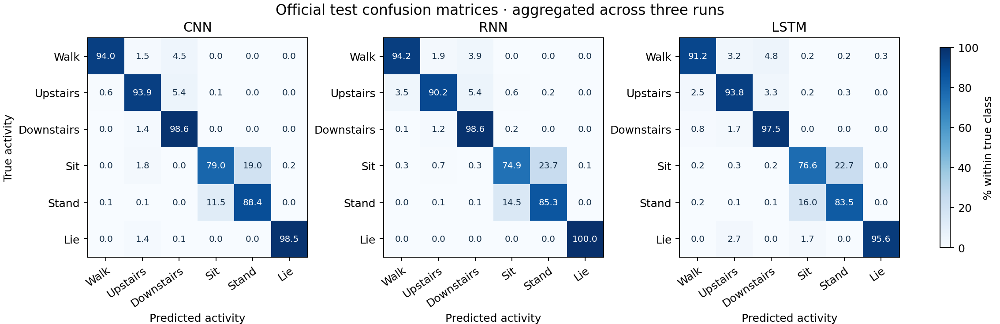
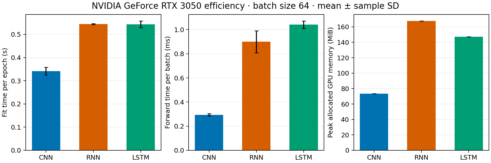
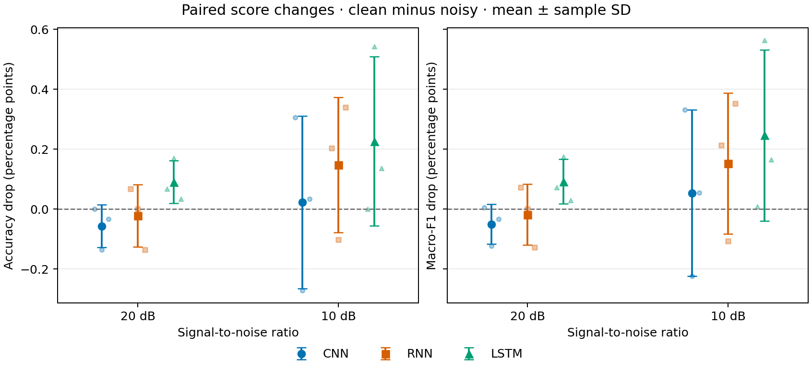
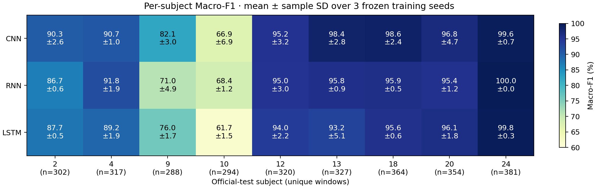
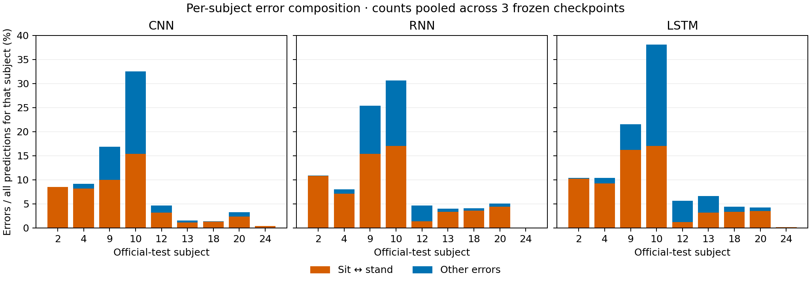

# CNN RNN 与 LSTM 的跨受试者人体活动识别比较

## 摘要

针对个人计算机条件下人体活动识别模型的选择问题，本文在 UCI HAR 数据集上比较参数规模接近的 CNN、普通 RNN 与 LSTM。按受试者划分数据，三种模型采用相同的学习率候选与早停规则，各用三个随机种子完成训练，冻结九个检查点后统一测试。CNN、RNN 和 LSTM 的测试 Macro-F1 分别为 91.94%、90.44% 和 89.61%；CNN 计算开销较低，但训练波动较大。后续逐受试者分析发现，两名受试者仅占 19.75% 的测试窗口，却贡献三种模型各自 56%–61% 的错误；CNN 在九人中的六人上平均 Macro-F1 领先。相同人工噪声下，10 dB 扰动使三者的 Macro-F1 平均下降 0.054、0.152 和 0.246 个百分点，部分活动的退化被总体指标掩盖。结果支持将 CNN 作为当前设置的优先基线，同时说明模型比较需要结合训练波动、受试者差异及类别错误解释。

**关键词：** 人体活动识别；卷积神经网络；循环神经网络；长短期记忆网络；噪声鲁棒性

## 1 引言

基于惯性传感器的人体活动识别将多通道时间序列映射为活动类别，是研究序列建模的典型任务。UCI HAR 提供统一采集与标注的智能手机传感器数据，并保留受试者编号，适合开展跨受试者比较[1]。在有限计算资源下，模型选择除了关注识别性能，还需要考虑训练时间、推理开销及结果的可重复程度。

卷积网络通过局部卷积和共享权重提取时间模式；普通循环网络逐步更新隐状态，显式利用序列顺序；LSTM 则引入记忆单元与门控机制，以缓解长时间跨度学习中的梯度传播困难[2]。既有研究已将卷积与 LSTM 结合用于可穿戴活动识别，说明局部特征提取与时间建模具有互补潜力[3]。但模型结构的理论特点并不直接决定特定数据、预算和实现下的优劣，复杂度更高的序列单元也需要通过实际实验检验其收益。

本文围绕三个问题展开：在接近的参数规模和相同调参预算下，三种基础模型如何比较；平均性能是否掩盖训练波动与受试者之间的差异，计算效率能否补充模型选择；固定模型面对相同人工扰动时，整体分数和类别错误如何变化。研究贡献是建立可核查的比较流程，并通过受试者与活动类别两个层面的错误分析，明确总体模型排名的适用范围。

## 2 材料与方法

### 2.1 数据与受试者划分

UCI HAR 包含 30 名受试者的步行、上楼、下楼、坐姿、站姿和躺卧六类活动。数据采样率为 50 Hz，窗口长度为 2.56 s，即 128 个时间点，相邻窗口重叠 50%[1]。本文读取官方 Inertial Signals 中的三轴身体加速度、三轴角速度和三轴总加速度，组成 128×9 的输入。该输入已经过数据集提供方的滤波与分窗处理，因此本文的比较建立在官方预处理信号之上。

官方训练集包含 21 名受试者、7,352 个窗口，官方测试集包含 9 名受试者、2,947 个窗口。以划分种子 2026 将官方训练集进一步分为 17 人、5,844 个窗口的训练集和 4 人、1,508 个窗口的验证集。验证受试者编号为 1、19、25、26；测试受试者编号为 2、4、9、10、12、13、18、20、24。三个集合的受试者互不重叠，避免同一人的重叠窗口跨集合分布。

每个通道的均值 μ_c 和标准差 σ_c 仅由训练集全部窗口与时间点计算，标准化为 x̃_itc=(x_itc−μ_c)/σ_c。验证集和测试集直接使用同一组统计量。正式训练始终保留验证集用于选择训练轮次，没有将其并入训练集。

### 2.2 模型结构与参数规模

CNN 采用三层一维卷积，通道数依次为 9→32→64→64，卷积核长度均为 5，填充为 2，每层卷积后接 ReLU。前两层后使用步长为 2 的最大池化，第三层后使用全局平均池化。分类头包含丢弃率为 0.2 的 Dropout 和六分类线性层，总计 32,710 个可训练参数。

RNN 为单层、单向的 tanh 循环网络，隐藏维度为 176；LSTM 为单层、单向网络，隐藏维度为 80。两者均对全部时间步的输出取均值，再经 Dropout 和线性层分类，参数量分别为 33,974 和 29,606。三种模型规模接近，但参数量没有被强制设为完全相同；循环结构、激活存储和算子执行方式仍会影响实际开销。

### 2.3 调参与正式训练

三种模型使用 Adam 优化器[4]、交叉熵损失、批量大小 64、梯度范数裁剪阈值 1.0 和 Dropout 0.2。调参阶段统一使用随机种子 41，对学习率 0.0003、0.001 和 0.003 各训练一次，共九次候选实验。每次最多训练 50 轮；验证 Macro-F1 连续八轮未提高时停止，并保留验证 Macro-F1 最高的检查点，同分时保留较早轮次。模型内部按未舍入的最佳验证 Macro-F1 选择学习率，若相同则优先较小学习率。这一预算约束统一了候选数量和停止规则，实际训练轮数与墙钟时间允许因模型而异。

学习率选定后，分别以种子 42、43、44 从头训练，共得到九次正式实验。正式模型继续按验证 Macro-F1 选取检查点。检查点在正式测试前统一冻结并记录 SHA-256，随后对全部九个模型评估官方测试集，不依据测试分数选择种子或重新训练。随机种子控制初始化、样本顺序等过程，运行环境启用确定性算法。

实验在 Intel Core i5-12490F、16 GB 内存及 NVIDIA GeForce RTX 3050 8 GB 显卡的计算机上完成，使用 Python 3.10.22、PyTorch 2.6.0+cu124，CPU 线程数设为 4。

### 2.4 评价指标与效率统计

准确率为预测正确的窗口数占总窗口数的比例。对类别 c，F1_c=2TP_c/(2TP_c+FP_c+FN_c)，Macro-F1 为六个类别 F1 的算术平均。结果报告三个正式种子的均值与样本标准差，标准差的分母为 n−1=2。它描述固定数据划分下训练随机性的波动，不代表新受试者总体上的置信区间。

训练时间包括各轮训练、验证和检查点写入，排除数据准备、绘图与进程启动。单轮耗时由一次训练的总耗时除以实际完成轮数得到。推理时间使用已驻留 GPU 的 64 个验证窗口，预热五次后重复前向计算 30 次，并在计时边界同步 GPU；该数值不含数据传输，也不等同于单样本实时响应延迟。显存指标为 PyTorch 分配的峰值，不包括 CUDA 上下文及其他程序占用。

### 2.5 冻结模型的人工噪声实验

噪声实验是在观察干净测试集结果后开展的后续描述性研究。开始噪声评分前固定 20 dB 和 10 dB 两档信噪比、随机种子及处理方法，直接复用九个冻结检查点，不微调模型。首先复算干净测试结果，确认指标与混淆矩阵和正式实验一致。

设 x_itc 为已按训练统计量标准化的输入，i、t、c 分别表示窗口、时间点和通道。使用 NumPy PCG64、种子 20261109 生成一个形状为 2,947×128×9 的标准正态噪声模板 g。逐窗逐通道计算：

P_ic=(1/128)Σ_t x_itc²；q_itc=g_itc/√[(1/128)Σ_t g_itc²]。

在目标信噪比 S 下，扰动后的输入为：

x′_itc=x_itc+q_itc√P_ic·10^(−S/20)。

这里功率采用包含直流分量的均方值，模板只按 RMS 缩放，不另作去均值。两档条件使用同一模板的不同幅度，所有模型和训练种子在同一条件下接收完全相同的输入。加噪后转换为 float32，不裁剪或重新标准化。该方式可控制每个窗口、每个通道的目标信噪比，但经 RMS 约束后的扰动并非严格独立同分布的高斯噪声。

对每个检查点计算配对下降量 ΔM=100×(M_clean−M_noise)，单位为百分点（pp），随后汇总三个训练种子的均值和样本标准差。负值表示分数小幅上升。所有种子共用一个噪声实现，因此这些标准差不衡量噪声抽样本身的不确定性。

### 2.6 逐受试者分析

在已知原正式测试和噪声结果后，复用九个冻结检查点开展逐受试者描述性分析，不改变模型或训练配置。重新获得每个测试窗口的预测，先核对全体混淆矩阵与原正式结果完全一致，再按受试者编号分组；各组混淆矩阵相加必须还原全体计数。每名测试受试者均包含六类活动。

对每个模型、种子和受试者分别计算准确率与六类 Macro-F1，再对同一人的三个训练种子汇总均值与样本标准差。另在每个训练种子内对九名受试者的指标等权平均，最后汇总三个种子，以区别于直接合并全部窗口的评价。Macro-F1 不是线性指标，两种口径不能直接互换。错误构成采用同一受试者的三个检查点混淆计数之和；这些重复预测不增加独立受试者数量。分析仅用于解释既有测试结果，不能替代新的独立验证。

## 3 结果

### 3.1 验证集调参

表 1 展示九个候选的最佳验证 Macro-F1。三种模型均在学习率 0.003 时取得本次候选范围内最高值，因此正式训练采用该学习率。其位于搜索网格上边界，现有实验只能确定网格内的选择，尚不能判断更大学习率是否有益。所有候选均因早停在 50 轮之前结束。

表 1　等预算学习率搜索的验证 Macro-F1（%）

| 模型 | 0.0003 | 0.001 | 0.003 | 选定学习率 |
| --- | ---: | ---: | ---: | ---: |
| CNN | 96.78（9/17） | 97.04（3/11） | 98.01（6/14） | 0.003 |
| RNN | 95.09（31/39） | 96.68（15/23） | 97.55（10/18） | 0.003 |
| LSTM | 93.57（17/25） | 94.83（17/25） | 97.38（8/16） | 0.003 |

注：括号内为最佳检查点轮次/实际完成轮数；调参随机种子统一为 41。

### 3.2 正式测试性能与错误分布

表 2 和图 1 给出正式实验结果。CNN 的测试 Macro-F1 均值最高，分别高于 RNN 和 LSTM 1.50、2.33 个百分点，但其种子间标准差也最大。三个模型的准确率和 Macro-F1 相近，说明两种总体指标在本数据上的排序一致。

表 2　三次正式训练的验证及官方测试结果（%，均值±样本标准差）

| 模型 | 验证 Macro-F1 | 测试准确率 | 测试 Macro-F1 |
| --- | ---: | ---: | ---: |
| CNN | 97.04±0.35 | 91.95±2.45 | 91.94±2.50 |
| RNN | 97.94±0.35 | 90.42±0.52 | 90.44±0.61 |
| LSTM | 97.34±0.81 | 89.49±0.76 | 89.61±0.71 |

图 1　三种模型的官方测试性能。每种模型使用三个训练种子，误差线表示样本标准差。

逐种子分析显示，CNN 在种子 42、43、44 下的测试 Macro-F1 分别为 94.14%、89.23% 和 92.45%。它在其中两次训练中领先，而种子 43 下 RNN 达到 90.76%，高于 CNN。CNN 的均值优势因此不能解释为每次训练都优于其他模型。

图 2 展示三个种子混淆计数汇总后的错误分布。CNN、RNN、LSTM 的坐姿与站姿相互误判分别为 463、581、590 次，占各自全部误判的 65.0%、68.6%、63.5%。CNN 在这一主要错误来源上的绝对误判数量较少，但三者均未充分分离这两个类别。汇总矩阵中的每个测试窗口被三个检查点各预测一次，计数增加不意味着获得了更多独立受试者。

图 2　官方测试集混淆矩阵。先汇总三个训练种子的计数，再按真实类别逐行归一化为百分比；每个检查点均评估同一组 2,947 个窗口。

### 3.3 计算效率

CNN、RNN 和 LSTM 实际完成的训练轮数分别为 13.7±4.5、21.3±3.5 和 12.3±0.6，总训练耗时分别为 4.62±1.38、11.62±1.92 和 6.71±0.50 s。表 3 显示，即使考虑训练轮数差异，CNN 的平均单轮耗时仍较低，同时具有较小的前向计算时间和显存占用。图 3 给出了各项效率比较。

表 3　正式实验的计算开销（均值±样本标准差）

| 模型 | 参数量 | 单轮耗时（s） | 64 窗口前向耗时（ms） | 峰值分配显存（MiB） |
| --- | ---: | ---: | ---: | ---: |
| CNN | 32,710 | 0.341±0.016 | 0.295±0.010 | 73.4±0.0 |
| RNN | 33,974 | 0.545±0.002 | 0.899±0.091 | 167.8±0.0 |
| LSTM | 29,606 | 0.544±0.015 | 1.041±0.031 | 147.3±0.0 |

图 3　三种模型的计算效率。时间与显存的统计范围见第 2.4 节，结果适用于本机硬件及当前实现。

### 3.4 人工噪声下的配对变化

表 4 同时报告加噪后的绝对分数和相对干净输入的配对下降。20 dB 下，CNN 与 RNN 的平均分数略升，LSTM 小幅下降。10 dB 下三者平均指标均下降，CNN、RNN、LSTM 的 Macro-F1 分别下降 0.054、0.152 和 0.246 个百分点。所有条件下，CNN 的平均绝对分数仍最高。

表 4　人工噪声下的平均分数与配对下降（下降量为均值±样本标准差）

| 模型 | SNR（dB） | 准确率（%） | Macro-F1（%） | 准确率下降（pp） | Macro-F1 下降（pp） |
| --- | ---: | ---: | ---: | ---: | ---: |
| CNN | 20 | 92.00 | 91.99 | −0.057±0.071 | −0.050±0.066 |
| CNN | 10 | 91.92 | 91.89 | 0.023±0.289 | 0.054±0.278 |
| RNN | 20 | 90.44 | 90.46 | −0.023±0.104 | −0.018±0.101 |
| RNN | 10 | 90.27 | 90.29 | 0.147±0.226 | 0.152±0.235 |
| LSTM | 20 | 89.40 | 89.52 | 0.090±0.071 | 0.092±0.075 |
| LSTM | 10 | 89.27 | 89.36 | 0.226±0.283 | 0.246±0.286 |

注：每行基于三个冻结检查点；负下降表示指标上升。下降量由未舍入的逐检查点分数计算，不能直接用表内两位小数重建。

图 4　人工噪声引起的准确率与 Macro-F1 配对下降，误差线表示三个训练种子下降量的样本标准差。

总体下降较小并不表示所有类别保持不变。CNN 的上楼召回率由 93.91% 降至 10 dB 下的 92.85%，下降 1.06 个百分点，明显大于其总体准确率的平均下降。其他类别的正确预测增加抵消了部分退化，故单个总体分数不足以描述完整影响。

### 3.5 受试者之间的性能与错误差异

图 5 展示九名测试受试者的 Macro-F1。按每人的三个种子均值比较，CNN 在六人上领先；RNN 在 4、10、24 号受试者上领先，LSTM 未取得单人的最高均值。10 号是三种模型共同表现最低的受试者，CNN、RNN 和 LSTM 的 Macro-F1 分别为 66.91±6.86%、68.39±1.17% 和 61.66±1.54%。24 号的对应结果则为 99.59±0.70%、100.00±0.00% 和 99.84±0.28%。这表明总体约 90% 的分数背后存在明显的受试者差异。

图 5　逐受试者 Macro-F1（%，三个训练种子的均值±样本标准差）。n 为该受试者的唯一测试窗口数；标准差描述同一受试者上的训练波动。

按受试者等权计算后，模型的平均排名保持不变，但 Macro-F1 均低于合并全部窗口时的分数（表 5）。每人的窗口数量和类别分布不同，加之 F1 的非线性，使两种统计口径得到不同结果。等权口径强调每名受试者具有相同权重，并不意味着获得了新的独立样本或更强的统计显著性证据。

表 5　九名测试受试者等权汇总的结果（%，均值±样本标准差）

| 模型 | 等权准确率 | 等权 Macro-F1 | 逐人 Macro-F1 领先人数 |
| --- | ---: | ---: | ---: |
| CNN | 91.29±2.52 | 90.96±2.50 | 6/9 |
| RNN | 89.69±0.57 | 88.88±0.66 | 3/9 |
| LSTM | 88.73±0.80 | 88.14±0.54 | 0/9 |

注：先在每个训练种子内等权平均九人的指标，再计算三个种子的均值与样本标准差；领先人数按各受试者的三个种子 Macro-F1 均值比较。

9 号与 10 号合计提供 582 个窗口，占全部测试窗口的 19.75%，却贡献 CNN、RNN 和 LSTM 全部误判的 60.81%、57.73% 和 56.19%。图 6 进一步显示，坐姿与站姿虽然是总体主要混淆来源，但不能概括所有受试者的错误。10 号的 CNN 误判中，坐姿与站姿互判占 47.39%；此外，步行被判为下楼有 56 次，上楼被判为下楼有 46 次。这些次数是三个检查点的合并预测计数，说明该受试者的困难还涉及动态活动。

图 6　逐受试者错误构成。每段柱高为该类误判数占该受试者全部预测的比例，分母包含三个检查点的重复预测；橙色为坐姿与站姿互判，蓝色为其他错误。

## 4 讨论

### 4.1 验证集排序与跨受试者泛化

正式训练中，验证 Macro-F1 的均值顺序为 RNN、LSTM、CNN，而测试集顺序为 CNN、RNN、LSTM。验证表现最优的模型没有取得最高测试均值。逐受试者结果进一步表明，CNN 的均值优势并不覆盖所有人，且三种模型共同在 9 号与 10 号受试者上积累大量错误。因此，单个总体均值不足以说明模型面对每名新受试者时的可靠程度。四名验证受试者是否充分代表测试群体仍是待检验的问题，当前分组结果没有确定验证与测试排序变化的具体原因。

CNN 还表现出较大的训练波动。种子 43 的最佳验证检查点出现在第一轮，最终测试 Macro-F1 低于另外两个 CNN 种子，而其验证分数没有同等幅度下降。保留全部三次结果能够呈现这种不稳定性，避免单个最佳种子掩盖方法的实际风险。由三次运行得到的均值优势仍需更多随机种子和受试者划分检验。

### 4.2 主要错误与模型选择

三种模型超过六成的错误集中在坐姿与站姿之间，而逐受试者分析发现，困难受试者还存在较多动态活动混淆。改进方向因此需要同时考虑活动类别和个体差异：只优化总体最多的坐姿与站姿错误，可能仍无法解决 10 号受试者的步行、上楼与下楼识别问题。个体动作、姿态和传感器方向可能影响惯性信号，但本文未通过对应测量或消融确定错误原因，后续应结合通道贡献及独立受试者数据检验这些解释。

在当前预算下，CNN 同时取得较高的测试均值和较低的计算开销，适合作为本项目的优先基线。LSTM 参数更少却推理更慢，也说明参数量不能单独替代执行效率评估。门控序列模型在更长序列或其他任务中可能具有价值，但当前 128 步输入、单层结构和训练预算没有显示其性能收益。本文结果针对具体实现，不构成对所有 CNN、RNN 或 LSTM 变体的整体排名。

### 4.3 对小幅噪声变化的解释

10 dB 条件下 CNN 的平均下降最小，但三个模型的 Macro-F1 下降标准差均大于平均下降量。个别检查点在加噪后还有小幅提升，例如 CNN 种子 43 在 10 dB 下提高约 0.224 个百分点。这可能反映少量靠近决策边界的窗口在扰动后改变预测方向；单次噪声实现无法确认其原因，更不能据此认定测试时加噪能够稳定改善性能。本文未进行统计显著性检验，不将这些小差异表述为显著优势。

同时，噪声以每个标准化窗口的信号功率为参照，并在已有滤波后的模型输入端加入。它回答的是给定输入空间扰动下模型输出有多敏感。上楼召回率的变化进一步说明，低平均下降可能包含不同类别间的相互抵消，分析噪声鲁棒性时应同时检查类别指标与混淆结构。

## 5 局限性

本研究使用一个数据集、一次固定受试者划分和三个训练种子。重叠窗口存在相关性，重复预测同一测试集也没有增加独立样本量；现有样本标准差不足以估计对新群体的泛化不确定性。逐受试者分析揭示了误差集中现象，但仍使用原来的九人，没有实施重复受试者划分，也未验证特定个体表现较差的原因。调参仅覆盖三个学习率，且最优候选均位于上边界，尚未搜索隐藏维度、池化策略或正则化强度。相同候选数量与早停规则提高了过程可比性，但不代表各类网络均已达到自身最优配置。

噪声实验只使用一个随机模板及两档强度，未覆盖偏置漂移、旋转、丢包或真实设备噪声。每个重叠窗口独立生成扰动，因此不构成时间连续的原始传感器噪声模拟。该研究是在干净测试结果已知后追加的描述性分析；检查点固定降低了后续模型调整的影响，却不能将整个实验解释为测试前预注册的完整设计。未来需要在新的受试者划分或独立数据上，结合多个噪声种子检验结论。

## 6 结论

在 UCI HAR 的固定跨受试者划分、接近参数规模和统一调参预算下，CNN 以 91.94% 的平均测试 Macro-F1 取得三者中的最高结果，并具有较低的训练、推理及显存开销；RNN 与 LSTM 的平均测试 Macro-F1 分别为 90.44% 和 89.61%。CNN 在九名测试受试者中的六人上领先，但训练波动较大，且三种模型超过一半的错误集中于仅占约五分之一窗口的两名受试者。10 dB 人工噪声下三者平均 Macro-F1 下降均小于 0.25 个百分点，部分活动类别的退化仍可被总体均值掩盖。综合结果支持将 CNN 用作当前项目的基础模型，并优先研究困难受试者的活动混淆、在独立受试者数据上检验改进，以及通过重复噪声实验评估结果稳定性。

## 参考文献

[1] REYES-ORTIZ J, ANGUITA D, GHIO A, et al. Human Activity Recognition Using Smartphones[DS]. UCI Machine Learning Repository, 2013. DOI: 10.24432/C54S4K. [数据集及官方说明](https://archive.ics.uci.edu/dataset/240/human+activity+recognition+using+smartphones).

[2] HOCHREITER S, SCHMIDHUBER J. Long short-term memory[J]. Neural Computation, 1997, 9(8): 1735–1780. DOI: 10.1162/neco.1997.9.8.1735. [作者机构提供的论文](https://www.bioinf.jku.at/publications/older/2604.pdf).

[3] ORDÓÑEZ F J, ROGGEN D. Deep convolutional and LSTM recurrent neural networks for multimodal wearable activity recognition[J]. Sensors, 2016, 16(1): 115. DOI: 10.3390/s16010115. [期刊原文](https://www.mdpi.com/1424-8220/16/1/115).

[4] KINGMA D P, BA J. Adam: A method for stochastic optimization[C]//International Conference on Learning Representations. 2015. [作者论文，arXiv:1412.6980](https://arxiv.org/abs/1412.6980).
